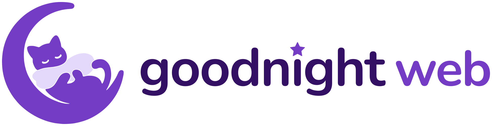

<picture>
  <source media="(prefers-color-scheme: dark)" srcset="brand/goodnight-web-lockup-dark.svg">
  
</picture>

# goodnight-web

goodnight-web は、Webサイト、ブログ、問い合わせフォームをまとめたスターターキットです。Cloudflare だけで動きます。1 つの Worker が静的なサイト、問い合わせ API、問い合わせを読むための管理画面を配信し、1 つの D1 データベースに問い合わせを保存します。

[English](README.md)

## デプロイ

[](https://deploy.workers.cloudflare.com/?url=https://github.com/iktakahiro/goodnight-web/tree/main/templates/starter)

このボタンは、スターター（`templates/starter`）を、あなたの GitHub アカウントの新しいリポジトリにコピーして、あなたの Cloudflare アカウントにデプロイします。設定とシークレットは[スターターの README](templates/starter/README.ja.md) を参照してください。

## 目的

- サーバー、言語のランタイム、データベースサーバーを自分で保守せずに、小さな会社のWebサイトを運用できるようにする。
- 問い合わせを確実に受け取る。問い合わせは D1 に保存してから応答を返す。スパム対策には Turnstile、Workers の Rate Limiting、honeypot 欄を使う。
- エンジニアでない人でも、AI ツールなどでサイトを編集できるようにする。問い合わせ API と管理画面はパッケージから提供し、利用者は編集しない。
- 修正は依存関係を更新するプルリクエストとして届ける。サイトの持ち主は、そのプルリクエストを確認してマージする必要がある。この保守は残る。

利用者が目にするものは、すべて日本語と英語に対応しています。

## 構成

| パス                         | 内容                                                                                   |
| ---------------------------- | -------------------------------------------------------------------------------------- |
| `packages/server`            | `@goodnight-web/server`: Worker、問い合わせ API、管理 API と管理画面、マイグレーション |
| `packages/astro`             | `@goodnight-web/astro`: 任意の Astro integration（必要になったときだけ追加）           |
| `packages/typescript-config` | 共通の TypeScript 設定                                                                 |
| `templates/starter`          | 利用者がコピーして編集する Astro のサイト                                              |
| `apps/docs`                  | ドキュメントサイト                                                                     |
| `docs`                       | 開発者向けのドキュメント                                                               |
| `brand`                      | ロゴ、ファビコン、アプリアイコンのファイルと、それを作るスクリプト                     |

詳しくは [docs/architecture.md](docs/architecture.md)（英語）を参照してください。

## 開発

[Bun](https://bun.sh) が必要です（バージョンは `.bun-version` を参照）。

```sh
bun install
bun run validate
bun run build
```

開発のルールは [AGENTS.md](AGENTS.md)（英語）にあります。脆弱性の報告方法は [SECURITY.md](SECURITY.md) を参照してください。

## ライセンス

[MIT](LICENSE)
